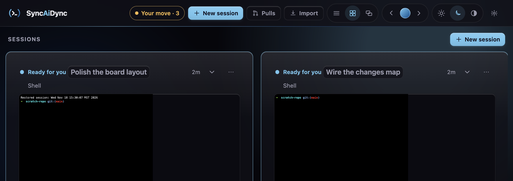
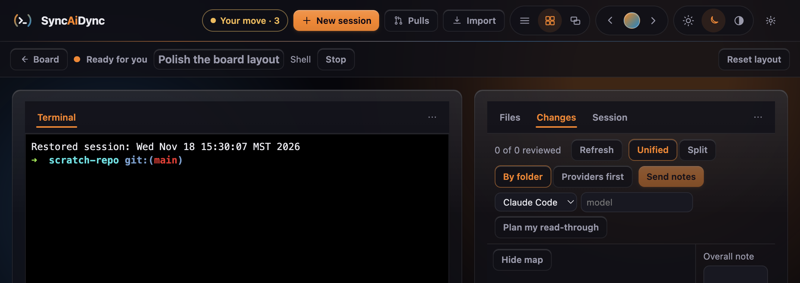

# SyncAiDync

SyncAiDync runs Claude Code, Codex, Pi, and Cursor Agent sessions on one local board. Your move
shows which sessions are blocked on you or ready for you. Each session has a workspace with a
terminal, file editor, changes review, and close-out.





## Install and run

You need macOS or Linux, a stable Rust toolchain, Git, and at least one supported agent CLI
installed and signed in. GitHub pull requests require a signed-in GitHub CLI (`gh`).

```sh
cargo install --git https://github.com/cfcomputing/syncaidync --locked syncaidync
syncaidync
```

The command opens the board in your browser. Choose **New session**, pick an agent and a
workspace, and enter a prompt. Claude Code sends hooks for state changes. Codex, Pi, and Cursor
Agent use some or all terminal activity to infer state, so a quiet but running agent can appear
ready before it finishes.

## Tour

- **Board** switches between rows, a grid, and free placement. Open a session for the full
  workspace or use its terminal from the card.
- **Your move** puts sessions that need you in one place. Snooze a session to hide it from
  Your move and Wake it when you want it back.
- **Workspace** opens Terminal, Files, Changes, and Session. Tools can be rearranged or opened
  in a separate window.
- **Changes** compares the workspace with its starting point. Mark files as reviewed, add notes,
  follow the change map, or ask an agent to plan a read-through.
- **Pull requests** opens a GitHub pull request by URL or `owner/repo#number`. Start a review
  session with Terminal and Changes side by side, or add notes and prepare a draft review to
  submit on GitHub.
- **Goals** let you set checks for a session and review its report when it meets them. The report
  offers a local commit and, for a worktree, a merge into its base branch.
- **Close out** lets you write or suggest takeaways, choose where to save them, and stop, remove,
  or leave the session running.
- **Import** brings an existing Claude Code conversation onto the board as an ended session that
  can be resumed.

## Keyboard shortcuts

| Shortcut | Action |
|---|---|
| `Alt+]` / `Alt+[` | Focus the next or previous session |
| `Alt+N` | New session |
| `Alt+Enter` | Open the focused session’s workspace |
| `Alt+Z` | Snooze or wake the focused session |
| `Alt+0` | Back to the board |
| `Esc` | Close a dialog or menu |
| `Ctrl/Cmd+Enter` | Send the message in the Session tool |
| `Cmd+K` | Clear the focused terminal’s screen and scrollback |
| `Ctrl+Option+Cmd+S` | Show or hide the native macOS app |

## Configuration

| Environment variable | Purpose |
|---|---|
| `SYNCAIDYNC_HOME` | Data folder, defaults to `~/.syncaidync` |
| `SYNCAIDYNC_PORT` | Loopback port, defaults to `7717` |
| `SYNCAIDYNC_ROOTS` | Colon-separated directories to scan for Git repositories |
| `SYNCAIDYNC_NO_UPDATE_CHECK=1` | Disable the once-daily release check |
| `SYNCAIDYNC_BIN_CLAUDE`, `SYNCAIDYNC_BIN_CODEX`, `SYNCAIDYNC_BIN_PI`, `SYNCAIDYNC_BIN_CURSOR`, `SYNCAIDYNC_BIN_GH` | Optional overrides for installed CLI paths |
| `SYNCAIDYNC_WEB_DIR`, `SYNCAIDYNC_DEV_SHELL=1` | Serve local UI files and enable the development shell agent |
| `SYNCAIDYNC_KEY` | Supply a launch key for a wrapper, generated fresh by default |

Settings checks GitHub for SyncAiDync release tags at most once a day. Set
`SYNCAIDYNC_NO_UPDATE_CHECK=1` to disable it.

## Security

- The server listens on `127.0.0.1` and requires a loopback Host header.
- The launch key stays in memory and signs the browser in from a URL fragment.
- An agent uses a session-scoped credential to report signals and usage for that session.
- The Files tool stays inside the session workspace and excludes `.git`.
- Sessions and logs are stored on this machine. Agent CLIs, Git, and `gh` make their own network
  requests. The release check contacts GitHub.

## macOS app

On macOS 13 or newer, install the Apple command line tools and fetch the Rust dependencies with
`cargo fetch --locked`. Run `mac/build.sh` to build the bundle offline and install it in
`~/Applications`. Use `mac/build.sh --build-only` to build in `target/mac`. The wrapper is
built locally and ad-hoc signed. It uses the same interface with a Dock badge, native notifications,
and a global hotkey.

## Development

The Rust server is in `crates/syncaidync`, pure logic is in `crates/syncaidync-core`, and the
browser UI is in `web/`. Run `scripts/dev.sh` to serve `web/` from disk and enable the
shell agent. Reload the browser after an edit. Run `scripts/check.sh` for the test suite,
formatting, lints, and licence checks. See the [work orders](docs/plan/) for the project spec.

SyncAiDync is [MIT licensed](LICENSE). See the [third-party notices](THIRD_PARTY_NOTICES.md)
for vendored libraries.
